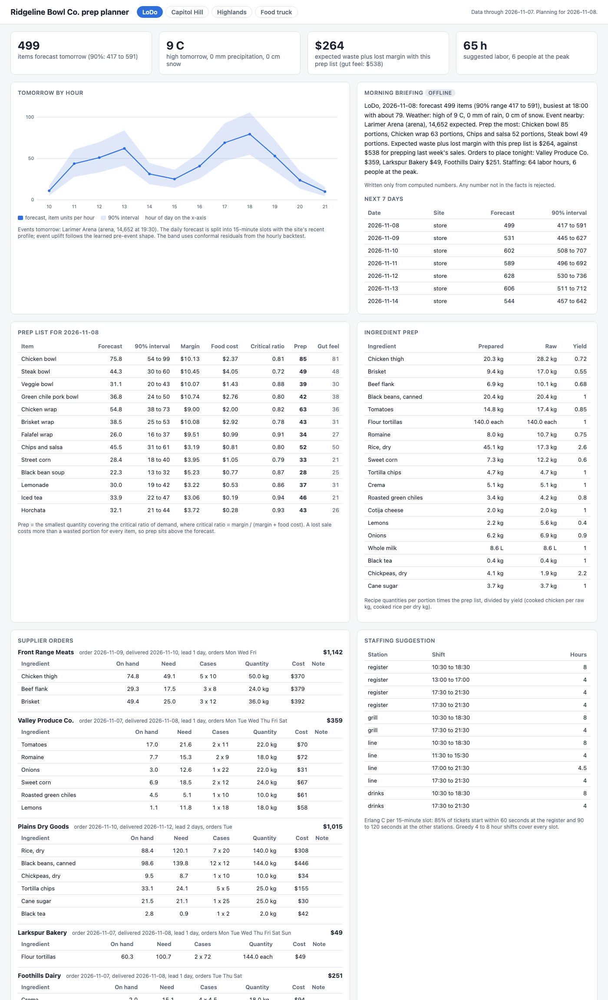
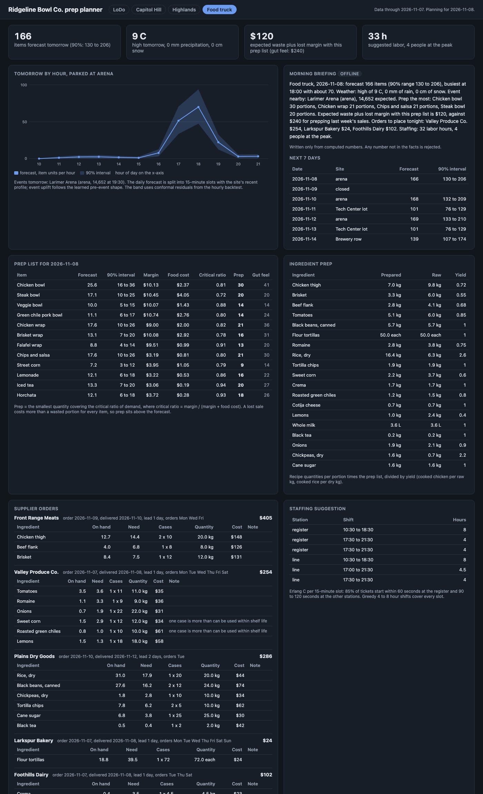

# Demand forecast and prep planning

Demand forecasting and kitchen planning for Ridgeline Bowl Co., a made-up fast-casual group with three restaurants in Denver and a food truck that moves between event sites. It generates two years of 15-minute sales per site with weather, events, holidays, promotions, a new menu item, and a site that opened 10 weeks ago. It forecasts every item at every site with gradient boosting and hierarchical reconciliation, backtests against baselines, and turns the forecast into tomorrow's prep list, supplier orders, and a staffing plan. A FastAPI service serves all of it with a web UI.



**Backtest**, item x location level (52 series), 12 rolling origins from 2026-05-09 to 2026-10-10:

| Horizon | Model | WAPE | MASE | Bias | 90% interval coverage | WAPE vs seasonal naive |
|---|---|---:|---:|---:|---:|---:|
| 1 day | Seasonal naive | 34.1% | 1.36 | +3.7% | | |
| 1 day | 7-day moving average | 23.7% | 0.93 | +2.9% | | -30.5% |
| 1 day | **GBM, bottom-up** | **15.9%** | **0.62** | +1.9% | 88.6% | **-53.4%** |
| 7 days | Seasonal naive | 30.3% | 1.11 | -1.2% | | |
| 7 days | 7-day moving average | 25.2% | 0.90 | -1.2% | | -16.7% |
| 7 days | **GBM, bottom-up** | **16.5%** | **0.64** | -1.0% | 90.2% | **-45.4%** |
| 28 days | Seasonal naive | 32.0% | 1.12 | -2.7% | | |
| 28 days | 7-day moving average | 27.2% | 0.92 | -2.6% | | -14.9% |
| 28 days | **GBM, bottom-up** | **16.9%** | **0.65** | -2.0% | 89.2% | **-47.2%** |

At the site level the GBM's 7-day WAPE is 8.2% (seasonal naive 19.7%), and for the whole group 4.6% (15.1%).

**Waste vs stockouts**, all four sites, 28 days simulated (2026-10-11 to 2026-11-07), one-day-ahead forecasts with models retrained weekly:

| Prep policy | Waste (food cost) | Lost sales (revenue) | Lost margin | Waste + lost margin | Fill rate | Stockout item-days |
|---|---:|---:|---:|---:|---:|---:|
| Gut feel (last week's sales) | $10,502 | $55,990 | $45,520 | $56,022 | 87.6% | 659 |
| Forecast mean | $6,207 | $40,652 | $33,096 | $39,303 | 91.1% | 667 |
| **Newsvendor quantile** | $14,479 | **$14,026** | **$11,142** | **$25,621** | **97.3%** | **241** |

The newsvendor policy throws out more food on purpose. A lost bowl costs about $10 of margin and a wasted one about $2.40 of food, so prepping above the mean pays: it cuts the combined cost by 54% against gut feel and 35% against the plain forecast.

## Why

A restaurant decides every evening how much chicken to cook and how many tortillas to order, and both mistakes cost money: food in the bin at close, or a guest who leaves when the steak bowl is gone. Most kitchens prep from last week's sales and a manager's feel for the weather and the ballgame. That works on ordinary days and fails on exactly the days that matter: rain on the patio, a sold-out concert two blocks away, a new menu item, a new site with no history. This repo is a small working version of the planning loop that replaces the gut call: forecast every item at every site, check the forecast honestly against baselines, and convert it to prep, orders, and labor with explicit costs.

## Architecture

```
 generator (seeded)              forecasting                                 planning
 ┌─────────────────────────┐   ┌───────────────────────────────────────┐   ┌─────────────────────────────────┐
 │ 4 sites x 13 items x    │   │ panels: item x site (52), site (4),   │   │ prep: newsvendor per item,       │
 │ 730 days x 48 slots     │──▶│   total (1); leakage-safe lags        │──▶│   recipe explosion with yields   │
 │ weather, holidays,      │   │ GBM (Poisson) per level and horizon   │   │ orders: lead time, order days,   │
 │ 548 events, promos,     │   │ cold start: analog site, class share  │   │   case packs, shelf life         │
 │ new item, new site,     │   │ reconcile: bottom-up / top-down /     │   │ labor: Erlang C per 15 minutes,  │
 │ truck schedule          │   │   MinT-lite; conformal intervals      │   │   greedy shifts                  │
 └─────────────────────────┘   │ 15-minute split with event shapes     │   │ simulation: 3 prep policies      │
                               │ rolling-origin backtest + gate        │   │ briefing: offline or Claude      │
                               └───────────────────────────────────────┘   └────────────────┬────────────────┘
                                                                                            ▼
                                     data/artifacts.json ──▶ FastAPI: /api/*, /healthz, /metrics, JSON logs, UI at /
```

| Piece | File |
|---|---|
| Sites, venues, menu, recipes, ingredients, suppliers | `src/demandcast/catalog.py` |
| Synthetic 15-minute history and known future calendar | `src/demandcast/generator.py` |
| Panels and leakage-safe features | `src/demandcast/features.py` |
| Baselines, GBM, cold start | `src/demandcast/models.py` |
| Reconciliation | `src/demandcast/reconcile.py` |
| Conformal intervals | `src/demandcast/intervals.py` |
| Fit, reconcile, split into 15 minutes | `src/demandcast/forecast.py` |
| Rolling-origin backtest and metrics | `src/demandcast/backtest.py` |
| Newsvendor prep and recipe explosion | `src/demandcast/prep.py` |
| Supplier orders | `src/demandcast/ordering.py` |
| Staffing | `src/demandcast/labor.py` |
| Month simulation | `src/demandcast/simulate.py` |
| Morning briefing (offline, Claude) | `src/demandcast/briefing.py` |
| End to end pipeline | `src/demandcast/pipeline.py` |
| API, metrics, logs, UI | `src/demandcast/app.py`, `metrics.py`, `logs.py`, `static/index.html` |

How each piece works:

- **Synthetic data.** Three stores (LoDo, Capitol Hill, Highlands) and a truck, 13 menu items in four classes, 48 quarter-hour slots from 10:00 to 22:00. Day totals come from a base level, growth, weekday and month effects, and holidays (closed on Thanksgiving and Christmas). Weather sets channel demand: rain and cold close most of LoDo's 33% patio share (35% of those guests move inside), and snow cuts walk-in traffic by 28% while delivery rises 45%. Events (baseball, football, arena, an amphitheater 21 km out, festival weekends) add 0.012 items per attendee, decaying with distance as `exp(-km / 0.8)`, shaped into the hours before the start. The truck parks at the day's biggest event, otherwise at an office lot on weekdays and a brewery row on weekends, and is closed on quiet Mondays and snow days. A new bowl launches 53 days before the end with a hype bump and half of its sales taken from the other bowls. Highlands opens 68 days before the end. Counts are Poisson per slot on top of lognormal day and item noise.
- **Features without leakage.** Every feature matrix is built from a copy of the history with everything after the cutoff set to missing. The model for horizon H only uses lags at least H days old (last week's same weekday becomes the same weekday 4 weeks back at H = 28). Calendar, weather, event attendance, the truck's site, and promotions are known in advance. Weather uses the actual values as a perfect forecast; production would use the forecast issued the night before.
- **Models.** One `HistGradientBoostingRegressor` with Poisson loss per level (item x site, site, total) and per horizon (1, 7, 28 days), with site, item, class, holiday, and parking spot as categorical features. Baselines: seasonal naive (same weekday in the latest week before the cutoff) and a 7-day moving average.
- **Cold start.** A new site takes its analog's forecast times a ratio of its sales to the analog's, shrunk toward a prior of 0.85 with 7 pseudo-days. A new item takes a share of its class forecast at the same site, shrunk toward a prior of 22%. Each switches to the GBM once it has a week of history past the forecast horizon. Over Highlands' first 8 weeks this brings 28-day WAPE from 31.3% (GBM alone) to 19.1%; over the new bowl's first 4 weeks, from 45.4% to 24.8% (seasonal naive: 53.1% and 78.2%).
- **Reconciliation.** Bottom-up, top-down (total split by 28-day historical shares), and MinT-lite (weighted least squares with each node's in-sample residual variance) are all backtested. **Bottom-up wins at every level and horizon** (7-day WAPE item / site / total: 16.5% / 8.2% / 4.6%, against 18.3% / 10.7% / 8.1% for MinT-lite and 24.9% / 18.1% / 10.4% for top-down), so it is the one used. The item model pools 52 series and sees each item's promotions and the new launches. The total model has 700 rows and has to learn a level shift from a site that did not exist; top-down also gives the new site and item a historical share near zero. MinT-lite should beat bottom-up in theory, but in-sample residuals flatter the small upper-level models, so it trusts them too much. The choice is made by the backtest each run, not hard-coded.
- **Intervals.** Split conformal on scaled residuals, `(y - yhat) / (yhat + 1)^0.75`, per level and horizon. At each origin only scores from earlier origins whose target day is already in the past are used, so coverage is measured honestly: 88.6% to 90.2% at the item level against a 90% target, and 89.1% for the hourly band.
- **Event days.** At the site level the GBM's 7-day WAPE is 7.2% on event days (seasonal naive 20.8%) and 8.7% on normal days (19.1%). The intraday split puts the event uplift (forecast minus a no-event counterfactual from the same model) into a pre-event shape learned from past event days.
- **Prep.** Single-period newsvendor per item: overage cost Co is the portion's food cost from the recipe, underage cost Cu is the lost margin. Prep the smallest quantity covering `Cu / (Cu + Co)` of the demand scenarios (forecast plus conformal scores). Critical ratios run from 0.72 (steak bowl) to 0.94 (iced tea). Recipes give prepared quantity per portion; dividing by yield gives purchase units (0.15 kg cooked chicken is 0.21 kg raw at a 72% yield).
- **Orders.** For each order day, cover usage until the next delivery plus 95% safety stock for the uncertainty until then, minus stock projected at arrival. Cap at what can be used within shelf life after arrival, round to whole cases (down if rounding up would spoil, with a flag when even one case is too much), and flag items projected to run out before the delivery.
- **Labor.** Each station (register, grill, line, drinks; two stations on the truck) is an Erlang C queue per 15-minute slot. The station gets the fewest staff that start 85% of tickets within 60 seconds at the register and 90 to 120 seconds elsewhere. Shifts of 4 to 8 hours on the half hour are laid greedily until every slot is covered.
- **Morning briefing.** `briefing.facts()` turns tomorrow's numbers into pre-formatted strings. The offline writer (default) fills a template. The Claude provider (`DEMANDCAST_BRIEFING_PROVIDER=claude`, model `claude-opus-5-5`, `anthropic` imported lazily) gets the same facts; any number in its reply that is not in the facts makes the service fall back to the offline text and say so.



## How to run

Requires [uv](https://docs.astral.sh/uv/). Docker is optional and not needed to run anything here.

```bash
make install           # uv sync --python 3.12
make train             # generate, backtest, forecast, plan, simulate: about 1 minute, writes data/artifacts.json
make run               # API and UI on http://127.0.0.1:8824
```

Other commands:

```bash
uv run demandcast train --quick                  # 420 days, 4 origins, about 15 seconds
uv run demandcast backtest --quick --gate        # what CI runs; exits 1 unless GBM beats seasonal naive at 7 days
uv run demandcast backtest --json data/bt.json   # full backtest only

curl "localhost:8824/api/forecast?location=lodo&days=7&items=true"
curl "localhost:8824/api/forecast/hourly?location=truck"
curl "localhost:8824/api/prep?location=cap-hill"
curl "localhost:8824/api/orders?location=highlands&supplier=meats"
curl "localhost:8824/api/labor?location=lodo"
curl localhost:8824/api/backtest
curl localhost:8824/api/simulation
curl "localhost:8824/api/briefing?location=lodo"
curl localhost:8824/metrics
```

Other endpoints: `/api/locations`, `/api/forecast/total`, `/healthz`. Logs are one JSON object per line with a request id, echoed in the `x-request-id` header. If `data/artifacts.json` is missing, the service builds the quick version on startup.

With Docker: `make docker-build && make docker-run`. The container trains on first start if its data directory is empty. The image is built and smoke tested in CI, not on this machine.

Screenshots: with the server running, `make screenshot` drives headless Chrome to write the images in `docs/`.

## Tests

```bash
uv run pytest -q       # 99 tests, about 35 seconds
uvx ruff check .
```

- Generator (16): shapes and dates, same seed same data, no sales outside opening hours, weekday lunch peak, closed holidays, holiday dates, rain cuts patio demand below 40% of dry days, rain hurts the patio site more than the delivery-heavy one, snow raises delivery share by 30%+, ballpark days raise LoDo sales by 15%+, event effect decays with distance, the truck follows its event (including the far amphitheater), truck closures, new site and new item cold starts, cannibalization, promotion lift.
- Features and leakage (9): rolling means skip gaps, lags are at least H days old, masking hides everything after the cutoff, training rows stop at the cutoff, **perturbing every value after the cutoff leaves models and forecasts unchanged**, seasonal naive ignores the future, a model refuses targets beyond its horizon, closed days forecast zero, feature columns.
- Reconciliation (9): summing matrix, every method coherent, bottom-up keeps item forecasts, top-down splits the total, MinT-lite leaves coherent input alone and follows a low-variance node, inactive series excluded, historical shares sum to one, the live forecast sums items to sites to the group.
- Intervals (5): conformal coverage within 88 to 92% on overdispersed counts, finite-sample quantile, widths scale with the forecast, monotone quantiles, backtest coverage between 80% and 97%.
- Prep (9): newsvendor on a hand-worked discrete example (120) and a normal one (113.49), expected waste and shortage by hand, recipe explosion with yields, costs and critical ratios, prep above forecast, prep list ingredients equal the explosion.
- Orders (10): order days to placement days, a hand-worked order rounded to a case, the second order counts the first delivery, lead time, safety stock, shelf-life cap rounds down, single-case flag, run-out flag, long shelf life not capped by the forecast horizon, every live order line on an allowed day with the right lead time.
- Labor (7): Erlang C against a known value (4/9), service level rises with staff, minimum staff meets the target, shifts cover the requirement and are 4 to 8 hours, more demand needs more hours, two stations on the truck.
- Simulation (5): accounting identities and dollars by hand, policy quantities, closed days, newsvendor lowest total cost, same demand under every policy.
- Backtest (8): metrics by hand, MASE scale, origin spacing, intervals use only earlier origins, gate and improvement, every horizon, model, and level reported, GBM better on event days, cold start helps the new item.
- Briefing and API (21): offline briefing uses only computed numbers, invented numbers caught, Claude provider against a fake client (accepts grounded text, falls back on an invented number), the default never imports `anthropic`, health, metrics, every endpoint, 400 and 404, provider outage fallback, request id.

CI (`.github/workflows/ci.yml`) runs lint and tests, a **backtest gate** job that fails the build unless the GBM's 7-day item-level WAPE beats seasonal naive (it writes the tables to `$GITHUB_STEP_SUMMARY` and uploads the JSON), and a Docker job that builds the image and smoke tests the API. `.github/workflows/nightly.yml` is the retrain job: a cron at 08:30 UTC (01:30 in Denver, after close) runs the gate, retrains, and uploads the artifacts.

## Production notes

- Sales would come from the POS export each night, and the history would need cleaning first: sales are censored by what was prepped (a sold-out item shows its prep quantity, not its demand), so stockout days would be flagged and their demand estimated before training.
- Weather would come from the forecast issued the night before, not actuals, and the events calendar from venue feeds with confirmed attendance. Both add error the backtest here does not include.
- The model would retrain nightly in a scheduled job (the nightly workflow shape), store each run's artifacts and backtest in object storage, and only promote a model that passes the gate. Forecast accuracy and interval coverage would be tracked on live data and alert when they drift.
- Prep would carry over: sauces and cooked rice keep for two or three days, which makes those items a multi-period problem. Orders would read real on-hand counts from inventory and be sent through the suppliers' ordering portals after a manager approves them.
- Labor would respect real constraints: availability, minimum rest, overtime, labor law breaks, and a cap on labor cost as a share of forecast sales, solved with an integer program instead of a greedy cover.

## License

MIT. See [LICENSE](LICENSE).
